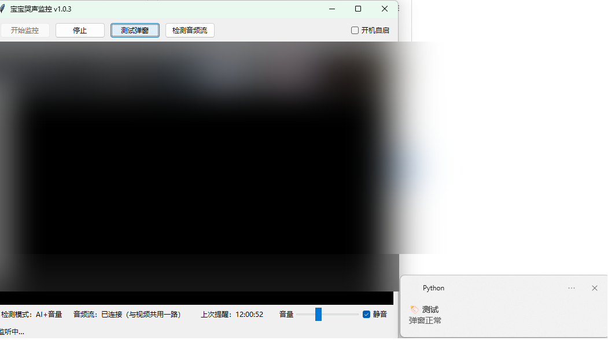

# 宝宝哭声监控（Windows 客户端）

拉取任意支持 RTSP 的网络摄像头的音视频流：窗口里看实时视频，
后台分析音频，检测到宝宝哭声后 Windows 右下角弹窗提醒。

## 运行截图



视频画面已打码处理；检测到哭声时右下角弹窗提醒。

## 检测原理

两级流水线，全部离线、本机运行：

1. **能量门**（常开）：0.5 秒一块音频，音量超过阈值且持续 `loud_seconds` 秒才往下走——过滤安静时段，省 CPU。
2. **YAMNet AI 确认**：Google 的 16MB 离线小模型（`assets/yamnet.tflite`），自带"婴儿哭声"类别，
   对最近 3 秒音频打分，超过 `yamnet_threshold` 才触发。触发后冷却 `cooldown_seconds` 秒。

YAMNet 加载失败时自动降级为**纯音量模式**（界面会显示），功能不受影响，只是误报稍多。

## 动作监测（v2.0.0 新增）

视频帧差法：只看婴儿床区域内的画面变化，全部离线、本机运行。

- 点"框选婴儿床"，在画面上拖出婴儿床的方框（红框会留在画面上）；右键清除区域，恢复看整幅画面。
- 框里持续动 2 秒 → 右下角弹窗"宝宝在动"；动作突然加剧（强度超过阈值持续 1 秒）→ 弹窗"宝宝动得很厉害"。
- 开灯、红外夜视切换这类整幅亮度跳变会被忽略，不误报；弹窗后冷却 60 秒，防刷屏。
- 每次提醒都会记进 `baby_cry_monitor.log`（带时间和强度），跑几天后翻日志就能数误报有几次，再调阈值。
- 状态栏会实时显示动作分数（如"动作：安静 0.004"），分数够 0.005 就记进日志；调阈值时看这个数，不用猜。

如实说明——它只能报"动了"，以下两件事它做不了：

- **吐奶**：奶是少量白色液体，在画面上几乎看不见，靠摄像头检不出来。能帮上忙的是间接信号：吐奶时宝宝常伴随躁动、呛咳、哭——"动得很厉害"或哭声提醒响了就去看一眼。喂完先竖抱 20–30 分钟再放下，仍是最靠谱的预防。
- **尿床**：尿湿是床单上缓慢出现的湿斑，不是动作，摄像头检不出来；夜里红外画面是黑白的，湿斑更看不见。靠谱的是尿湿报警器（夹在尿布或铺在床单下的湿度感应器，湿了就响），几十块钱，现成的。

## 污渍监测（v2.1.0 试验）

上面那段"检不出来"说得太绝对了，改口：人眼盯着画面是能看见的——吐奶是嘴边新出现的白色，尿湿是身下新出现的深色水渍。所以加了个试验版，专门抓这种"一直不走的变化"：

- **不用再框选区域**：直接复用婴儿床区域（就是动作监测那个框）；没框就是看整幅画面。
- **只在白天测**：程序按画面色彩分判断，白天彩色画面才测；夜里红外画面是灰度，直接跳过（状态栏会显示"夜间暂停"），天亮自动恢复。
- **做法**：跟几分钟前的画面比，框里新出现一块亮斑、持续 60 秒 → 记一条"疑似吐奶"；新出现一块暗斑、持续 60 秒 → 记一条"疑似尿湿"。开灯、拉窗帘这类整幅亮度跳变会被忽略；10 分钟没动静就刷新一次参考画面，跟上被子、光线这类慢变化。
- **试验期只记日志、存截图，不弹窗**：每次疑似都会记进 `baby_cry_monitor.log`，并在 exe 旁边的 `stain_snapshots/` 里存一张当时画面的截图。跑几天后翻截图，就能数它报得准不准，再决定要不要开弹窗（把 `stain_trial_mode` 改成 false 就开弹窗了）。

如实说明——试验版有两个没验过的点：

- **灵敏度没验过**：误报率跑几天能看出来，但真吐奶/真尿湿时它报不报得出来，得有一次真实画面才能验。手头有摄像头拍到的吐奶或尿湿截图，可以拿来调阈值。
- **宝宝挪位置可能误报**：宝宝挪到新地方、身体停在那儿不动，也会形成一块一直不走的亮斑或暗斑。试验期先靠截图人工判断；如果这类误报太多，再加"刚有过大幅度动作就暂缓"的过滤。

## 安装

1. 从 [Releases](../../releases) 下载 `BabyCryMonitor.exe`，放到任意目录（建议单独建个文件夹）。
2. 下载 ffmpeg（必需，没有它视频和音频都起不来）：打开 [gyan.dev ffmpeg 构建页](https://www.gyan.dev/ffmpeg/builds/)，下载 `ffmpeg-release-essentials.zip`（约 114 MB），解压后把里面的 `ffmpeg.exe` 放到 exe 同目录。
3. 下载 YAMNet 模型（可选，没有它也能用，只是哭声判断退化为纯音量模式、误报稍多）：打开 [YAMNet tflite 下载页](https://tfhub.dev/google/lite-model/yamnet/classification/tflite/1?lite-format=tflite)，把下载到的文件改名成 `yamnet.tflite`，放到 exe 同目录的 `assets/` 文件夹里（没有就新建一个）。
4. 双击运行，首次运行会自动生成 `config.json`。
5. 用记事本打开 `config.json`，把 `rtsp_video_url` / `rtsp_audio_url` 改成你摄像头的 RTSP 地址
   （一般在摄像头后台或说明书里找，例如 `rtsp://192.168.1.100:554/stream1`）。
6. 点"开始监控"。

装好后目录长这样：

```
某个文件夹/
  BabyCryMonitor.exe
  ffmpeg.exe                  ← 第 2 步下载的（必需）
  config.json                 ← 首次运行自动生成
  assets/
    yamnet.tflite             ← 第 3 步下载的（可选）
```

为什么拆开：v2.0.0 之前 ffmpeg 和模型是打进 exe 里一起发的，exe 113 MB，每次更新都要重新下载一整份。v2.1.1 起 exe 约 34 MB，ffmpeg 和模型一次下载、一直复用，以后更新只下 exe。如实说一句：第一次装的总下载量反而稍多（约 34 + 114 + 4 MB），省的是以后每次更新的量；只想"下载一次就能用"的，v2.1.0 的版本还在 Releases 里（72.9MB，ffmpeg 仍在里面）。注意：v2.1.0 的 exe 是 72.9MB，ffmpeg 其实还在里面（打包步骤没排干净）；v2.1.1 才真正把它排掉。

## 自检

点"检测音频流"：4 秒内收到数据且峰值正常 = 音频链路 OK。
在摄像头旁边拍手，峰值会明显跳动——这是最快的麦克风验证法。

如果连不上，检查两点：

- 摄像头后台的音频（伴音）开关是否打开；
- `config.json` 里的地址对不对（和电脑在同一局域网下）。

## 配置项（config.json）

| 项 | 说明 |
|---|---|
| `rtsp_video_url` | 视频流地址，窗口里显示的实时画面 |
| `rtsp_audio_url` | 音频流地址；程序只取声音不解视频，没有独立音频子码流的摄像头直接填视频流地址即可 |
| `energy_threshold` | 音量门阈值（0~1），误报多就调高 |
| `loud_seconds` | 持续大声多少秒才送 AI 判定 |
| `yamnet_threshold` | AI 哭声分数阈值（0~1），误报多就调高 |
| `cooldown_seconds` | 触发后冷却秒数，防消息轰炸 |
| `motion_roi` | 婴儿床区域 `[x0, y0, x1, y1]`（0~1 相对坐标），留空 = 看整幅画面；界面拖选后自动写入 |
| `motion_threshold` | 动作阈值（区域内变化像素占比），误报多就调高 |
| `motion_high_threshold` | 剧烈动作阈值，误报多就调高 |
| `motion_sustain_seconds` | 持续动多少秒才报"宝宝在动" |
| `motion_cooldown_seconds` | 动作提醒冷却秒数 |
| `stain_bright_threshold` | 亮斑阈值（比参考帧亮多少算吐奶候选），误报多就调高 |
| `stain_dark_threshold` | 暗斑阈值（比参考帧暗多少算尿湿候选），误报多就调高 |
| `stain_sustain_seconds` | 亮斑/暗斑持续多少秒才记录 |
| `stain_trial_mode` | true = 试验期只记日志、存截图，不弹窗；false = 疑似就弹窗 |

## 常见问题

- **exe 被 Defender 拦截**：PyInstaller 打包的程序常被误报，点"仍要运行"即可（代码开源可查）。
- **只有视频没声音**：先跑"检测音频流"自检；大概率是摄像头没开音频（伴音），或音频流地址不对。
- **白天误报多**：调高 `yamnet_threshold`（如 0.65）或 `energy_threshold`。
- **日志**：`baby_cry_monitor.log` 在 exe 同目录，报错先看它。
- **每次启动都弹 ffmpeg 防火墙提示**：旧版是打包方式的问题——每次启动 ffmpeg 都解到不同的临时目录，防火墙规则是按程序路径记的，点了允许下次还弹。v2.0.0 起程序会把 ffmpeg 固定到 `%LOCALAPPDATA%\BabyCryMonitor\ffmpeg.exe`，更新后第一次启动还会弹一次，点"允许访问"（勾专用网络即可）之后就不再弹了。

## 构建

打 tag 即自动构建：`git tag v1.0.0 && git push origin v1.0.0`，
GitHub Actions（windows-latest）会自动打出 `BabyCryMonitor.exe` 并建 Release。

v2.1.1 起是精简版：exe 里只打包程序本身和类别映射表（约 34 MB），
ffmpeg 和 YAMNet 模型不再打进去，由使用者按上面"安装"一节自己下载、
放 exe 旁（构建前会删掉 imageio-ffmpeg 包自带的 ffmpeg.exe，否则
PyInstaller 会把它当包数据又收进去——v2.1.0 就是这么漏掉的）。本地从源码跑
仍和以前一样（`pip install -r requirements.txt`，ffmpeg 走 imageio-ffmpeg，
模型放 `assets/yamnet.tflite`）。
